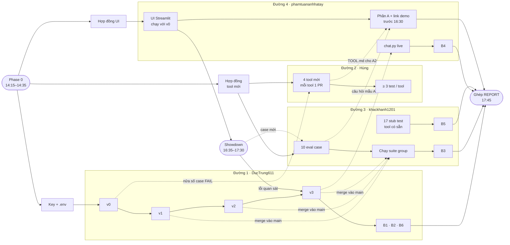

# Phân công nhóm — Day 03 Research Agent Tool Eval

Nhóm trưởng: **DucTrung611**. Thành viên: **Trần Mạnh Hùng (gitchung-mmm)**, **khackhanh1201**, **phamtuananhhatay**.

## Nguyên tắc để 4 người chạy song song

1. **Chốt hợp đồng trước, code sau.** Mọi thứ người này cần từ người kia (tên tool, tham số, định dạng event của agent) được chốt ở Phase 0 trong 20 phút. Sau đó không ai phải chờ ai.
2. **Mỗi file có đúng một chủ**; file dùng chung được chia thành vùng có chủ riêng (xem bảng cuối). Không ai sửa file của người khác.
3. **Mỗi người có một "đường chạy" độc lập** từ đầu đến cuối buổi, có thể chạy bằng v0 hoặc mock, không cần chờ v1/v2/v3.
4. **PR nhỏ, merge sớm, merge chéo.** Mỗi PR dưới ~1 giờ công. Review chéo giữa các thành viên, trưởng nhóm không là điểm nghẽn (xem "Quy tắc merge").
5. Vòng tối ưu v0 → v1 → v2 → v3 vẫn tuần tự (mỗi version dựa trên kết quả trước) nên do **một người** chạy. Nhưng các bạn khác hỗ trợ nó bằng cách chạy suite, phân tích lỗi song song (xem Đường chạy 1).
6. Không commit `.env`. Key chia riêng qua kênh nhóm.

## Sơ đồ phụ thuộc

Mũi tên liền: phải có mới làm được. Mũi tên đứt: bàn giao, có phương án dự phòng nếu chưa có (xem "Điểm bàn giao").

## Phase 0 — Khởi động (14:15–14:35, mọi người cùng lúc)

Việc của trưởng nhóm (làm trong 20 phút đầu, không ai chờ ngoài các điểm bàn giao dưới đây):

| # | Việc | Ai làm | Ai cần kết quả |
|---|---|---|---|
| 0.1 | Tạo `TEAM.md`, đẩy lên `main`. Tạo sẵn các vùng có chủ trong `tools.yaml` và `tests/test_tools_todo.py` (dòng comment `# === NEW TOOLS (Hùng) ===`) | Trưởng | Hùng, khackhanh1201 |
| 0.2 | **Chốt tên + chữ ký 4 tool mới** vào bảng "Hợp đồng tool mới" bên dưới (trưởng và Hùng quyết định cùng nhau, tối đa 15 phút) | Trưởng + Hùng | khackhanh1201, phamtuananhhatay |
| 0.3 | Chốt định dạng event của agent mà UI đọc (`tool_call`, `tool_result`, `final`), dựa trên `agent.py`/`chat.py` hiện có, ghi vào mục "Hợp đồng UI" bên dưới | Trưởng + phamtuananhhatay | phamtuananhhatay |
| 0.4 | Chia key (`.env`), chạy `preflight_provider.py`. Kẹt key quá 10 phút thì mượn máy nhóm khác | Trưởng | Tất cả |
| 0.5 | Mỗi người tạo nhánh `feat/<tên>`, cài môi trường, chạy `pytest` | Mỗi người | |

### Hợp đồng tool mới (điền ở bước 0.2)

| Tool | Mục đích (1 câu) | Args (kiểu, bắt buộc/tùy chọn) | Trả về khi thành công | Trả về khi lỗi |
|---|---|---|---|---|
| `<tool_1>` | | | | `{"error": "..."}` |
| `<tool_2>` | | | | `{"error": "..."}` |
| `<tool_3>` | | | | `{"error": "..."}` |
| `<tool_4>` | | | | `{"error": "..."}` |

Sau khi bảng này chốt, khackhanh1201 viết eval case cho tool mới chỉ dựa vào bảng, không cần chờ code của Hùng. Hùng chỉ được đổi chữ ký tool bằng cách sửa bảng này và nhắn cả nhóm.

### Hợp đồng UI (điền ở bước 0.3)

- Hàm/entry của agent mà `app.py` gọi: `<điền>`
- Cấu trúc một tool call hiển thị trên UI: `<điền>`
- Bước xác nhận: UI gọi `send` với `confirmed=false` trước, chỉ gọi lại `confirmed=true` khi user bấm xác nhận.
- `app.py` có ô chọn `--version` (v0 đến v3), nên chạy được ngay bằng v0 và tự dùng v3 khi có.

## 4 đường chạy song song

### Đường 1 — DucTrung611: Vòng tối ưu + tích hợp

Phụ thuộc đầu vào: không có (chạy được ngay sau Phase 0).

- Chạy baseline `v0`, liệt kê case FAIL, gán `failure_type`. **Chia phân tích:** sau khi có `runs/v0.json`, trưởng nhóm giao nửa số case FAIL cho Hùng phân tích (Hùng rảnh sau tool #2), nửa còn lại tự làm. Mỗi người ghi kết quả vào bảng riêng trong `reports/b1_failures.md`.
- Sửa `artifacts/system_prompt.md`:
  - bỏ chỉ dẫn xấu của starter (đoán thay vì hỏi, gửi không xác nhận, ép một bước)
  - thêm rule routing cho `timeline` / `social_search` / `lookup` / `fetch` / `clarify` và 4 tool mới
- Sửa vùng **tool có sẵn** trong `artifacts/tools.yaml`:
  - `description` mỗi tool nêu khi nào dùng / khi nào không dùng
  - quy ước args: handle không có `@`, `topic=news`, `timeframe`, `search_type=Top|Latest`
  - `send` chỉ gửi khi `confirmed=true`
- Chạy v1, v2, v3, mỗi version một giả thuyết, điền `artifacts/version_log.csv`. **Sau mỗi version: commit và merge ngay vào `main`** để khackhanh1201 chạy suite `group` và phamtuananhhatay chạy UI với bản mới mà không phải chờ.
- Review và merge PR (xem "Quy tắc merge").
- Viết **B1, B2, B6** vào `reports/b1.md`, `reports/b2.md`, `reports/b6.md`.
- **Nộp:** `version_log.csv`, `runs/*.json`, B1/B2/B6.

### Đường 2 — Trần Mạnh Hùng: Tool mới + test cho tool mới

Phụ thuộc đầu vào: bảng "Hợp đồng tool mới" (bước 0.2). Không phụ thuộc ai khác.

- Viết **≥ 4 tool mới** đúng contract trong `tools/README.md`: mỗi tool gồm `tools/<tên>/tool.py` và `TOOL.md`.
- Đăng ký trong `tools/__init__.py` (`TOOL_FUNCTIONS`).
- Viết entry `tools.yaml` của tool mới **trực tiếp trong vùng `# === NEW TOOLS (Hùng) ===`** (không gộp tay qua trưởng). Description theo mẫu: khi nào dùng / khi nào không dùng.
- Viết **≥ 3 test mỗi tool mới** (happy path; input xấu như chuỗi rỗng, sai kiểu, ngoài enum; nhánh lỗi trả error dict, không raise) trong vùng "YOUR NEW TOOL(S)" của `tests/test_tools_todo.py`.
- **Mỗi tool một PR riêng** (tool + TOOL.md + entry yaml + test). Không dồn đến cuối.
- Khi rảnh (sau tool #4 hoặc khi chờ review): nhận nửa số case FAIL v0 từ trưởng nhóm; thử agent của team khác ở showdown.
- Gửi mô tả từng tool cho phamtuananhhatay viết A2 (copy từ `TOOL.md`, không cần viết thêm).
- **Nộp:** 4 thư mục tool, test xanh, mô tả tool cho A2.

### Đường 3 — khackhanh1201: Unit test tool có sẵn + eval case nhóm

Phụ thuộc đầu vào: không có cho phần test tool có sẵn; bảng "Hợp đồng tool mới" cho case của tool mới (làm sau cùng).

- Điền **17 stub** `pytest.skip(TODO)` trong vùng tool có sẵn của `tests/test_tools_todo.py` (clarify, format, send, lookup, fetch, timeline, social_search, policy). Mục tiêu: `pytest` **0 failed, 0 skipped**. Mock HTTP bằng `fake_http`, không cần key.
- Challenge+: thử input biên (`limit=0`, `top_k=0`, `max_results="5"`, `items` thiếu `url`). Nếu tìm được bug: sửa, giữ test làm regression, ghi vào `reports/b5.md`.
- Viết **10 eval case** vào `data/eval_group.json` (5 single-turn, 5 multi-turn). Mỗi case cần `id`, `phase: "B"`, `query` hoặc `turns`, `failure_type`, `expect`, `metadata.what_it_tests`.
  - Thứ tự viết: 6 case cho tool có sẵn trước, 4 case cho tool mới sau (dựa vào bảng hợp đồng).
  - Phủ các loại lỗi: `wrong_tool`, `wrong_arg_value`, `wrong_boundary`, `unnecessary_tool`, `out_of_scope`, `missing_info`.
  - Có ≥ 1 case route tới mỗi tool mới của Hùng.
- **Chạy suite `group` mỗi khi `main` có version mới** (v1, v2, v3) để cho trưởng nhóm tín hiệu sớm, không chỉ chạy lúc cuối.
- Viết REPORT **B3** (`reports/b3.md`) và phần "Tool unit tests" của B5 (`reports/b5.md`).
- **Nộp:** `test_tools_todo.py` (phần tool có sẵn), `eval_group.json`, B3, B5.

### Đường 4 — phamtuananhhatay: UI + demo + REPORT Phần A

Phụ thuộc đầu vào: mục "Hợp đồng UI" (bước 0.3). Dùng v0 và tool có sẵn để dựng, không cần chờ v1 hay tool mới.

- Dựng **UI Streamlit** (`app.py`) bọc `agent.py`/`chat.py`: ô chat, ô chọn version, hiển thị tool calls, bước xác nhận trước khi `send`. UI là bắt buộc, cùng ≥ 4 tool mới là điều kiện lấy điểm thưởng.
- Tool mới của Hùng tự xuất hiện trong UI qua `TOOL_FUNCTIONS`, `app.py` không hard-code tên tool.
- Deploy bằng Cloudflare Tunnel (xem README), dán link vào A1.
- Viết REPORT **Phần A (A1–A3)** vào `reports/part_a.md`, có thể thêm `artifacts/poster.html`. **Hạn: trước 16:30.** A2 lấy mô tả tool từ `TOOL.md` của Hùng, A3 lấy câu hỏi mẫu từ khackhanh1201 (hai bạn chỉ cần gửi trước 16:00).
- Chạy `python chat.py --provider openrouter --version v3` ≥ 3 lượt live: request bình thường; request thiếu thông tin rồi bổ sung; request "gửi lên Telegram". Lưu transcript, viết **B4** (`reports/b4.md`).
- **Nộp:** `app.py`, link demo, poster, Phần A, B4, `transcripts/*.json`.

### Bonus (tuỳ chọn, chỉ làm khi v3 đã ổn)
- **Small Local Model (Ollama, Step 7)**: phamtuananhhatay sau khi xong UI, hoặc khackhanh1201 sau khi xong test. Ghi vào B7 (`reports/b7.md`).
- **`send` có transcript chứng minh xác nhận**: làm chung khi chạy live chat.

## Điểm bàn giao và phương án dự phòng

Ai cũng có việc để làm khi chưa nhận được đầu vào.

| Cần | Từ | Hạn | Nếu chưa có thì làm gì |
|---|---|---|---|
| Tên + chữ ký 4 tool | Trưởng + Hùng | 14:35 | Không có ngoại lệ, đây là việc đầu tiên |
| `main` có v1 / v2 / v3 | Trưởng | 15:10 / 16:10 / 17:45 | khackhanh1201 chạy suite trên version gần nhất; phamtuananhhatay dùng v0 |
| Mô tả tool cho A2 | Hùng | 16:00 | phamtuananhhatay viết A2 trước với 2 tool có sẵn, thêm tool mới sau |
| Câu hỏi mẫu cho A3 | khackhanh1201 | 16:00 | Lấy từ `data/eval_base.json` |
| Lỗi quan sát từ showdown | Trưởng, Hùng, khackhanh1201, phamtuananhhatay (cả bốn ghi) | 17:30 | Ghi vào `reports/showdown_notes.md`, mỗi người một dòng bắt đầu bằng tên mình |

## Mốc giờ theo lịch lớp (ca 14:00–18:00)

Lấy từ slide tiến độ của lớp. Giờ đã co theo tỉ lệ (14:00–14:15 ổn định lớp, lab chạy 14:15–18:00). Ca khác thì dịch theo giờ bắt đầu của ca.

```mermaid
gantt
    title Lịch song song ca 14:00–18:00
    dateFormat HH:mm
    axisFormat %H:%M

    section Mốc chung
    Phase 0 chốt hợp đồng          :crit, 14:15, 20m
    ≥ 1 tool mới qua contract test :milestone, 15:40, 0m
    Phần A + link demo             :milestone, crit, 16:30, 0m
    Showdown                       :active, 16:35, 55m
    Ghép REPORT + nộp              :crit, 17:45, 15m

    section DucTrung611
    Key + preflight                :14:15, 20m
    v0 + phân loại lỗi             :14:35, 35m
    v1                             :15:10, 30m
    v2 + suite group               :15:40, 30m
    Duyệt Phần A                   :16:10, 25m
    Demo + ghi lỗi                 :16:35, 55m
    v3 + B1 B2 B6                  :17:30, 30m

    section Hùng
    Chốt tên 4 tool                :14:15, 20m
    Tool 1 + 2                     :14:35, 35m
    Merge tool 1 + phân tích FAIL  :15:10, 30m
    Tool 3 + 4 + test              :15:40, 30m
    Gửi mô tả A2                   :16:10, 25m
    Thử agent team khác            :16:35, 55m
    Hoàn thiện test                :17:30, 30m

    section khackhanh1201
    Cài môi trường + pytest        :14:15, 20m
    Stub clarify format send policy :14:35, 35m
    Stub lookup fetch timeline social :15:10, 30m
    10 eval case                   :15:40, 30m
    Gửi câu hỏi A3                 :16:10, 25m
    Thử agent team khác            :16:35, 55m
    Suite group v3 + B3 B5         :17:30, 30m

    section phamtuananhhatay
    Hợp đồng UI + khởi tạo app     :14:15, 20m
    UI chạy với v0                 :14:35, 35m
    Hiển thị tool calls            :15:10, 30m
    Bước xác nhận send             :15:40, 30m
    Phần A + Cloudflare Tunnel     :crit, 16:10, 20m
    Giữ UI + tunnel                :16:35, 55m
    chat.py live + B4              :17:30, 30m
```

| Giờ | Mốc | Trưởng | Hùng | khackhanh1201 | phamtuananhhatay |
|---|---|---|---|---|---|
| 14:15–14:35 | **Phase 0** | 0.1–0.4, chốt hợp đồng | Chốt tên 4 tool cùng trưởng | Cài môi trường, `pytest` | Chốt hợp đồng UI, khởi tạo `app.py` |
| 14:35–15:10 | Baseline v0 + song song | Chạy v0, phân loại lỗi, chia nửa FAIL | Tool #1, #2 (PR riêng mỗi tool) | Stub test: clarify, format, send, policy | UI chạy ở `localhost:8501` với v0 |
| 15:10–15:40 | v1 + ≥ 1 tool mới | Sửa prompt/tools, chạy v1, merge | Tool #1 qua contract test, merge; phân tích nửa FAIL | Stub test: lookup, fetch, timeline, social_search; chạy `group` với v1 | UI hiển thị tool calls |
| 15:40–16:10 | Team eval + v2 | Chạy v2 + suite `group` | Tool #3, #4 + test | 6 case eval cho tool có sẵn, rồi 4 case cho tool mới | UI có bước xác nhận trước `send` |
| **16:10–16:35** | **REPORT Phần A + link demo** (**cứng: trước 16:30**) | Duyệt Phần A | Gửi mô tả tool cho A2 | Gửi câu hỏi mẫu cho A3 | Viết Phần A, chạy Cloudflare Tunnel, dán link |
| 16:35–17:30 | Team showdown | Demo, ghi lỗi | Thử agent team khác, ghi lỗi | Thử agent team khác, ghi lỗi | Giữ UI + tunnel chạy suốt buổi |
| 17:30–18:00 | v3 + REPORT Phần B + nộp | Chạy v3 từ lỗi showdown, B1/B2/B6, ghép report | Hoàn thiện test, thêm nửa số case showdown vào `eval_group.json` qua khackhanh1201 | Thêm case từ showdown, chạy `group` với v3, B3, B5 | `chat.py` ≥ 3 lượt, B4, transcript |

Các mốc cứng:
- Cuối 15:40: có ≥ 1 tool mới qua `pytest tests/test_tool_contract.py`.
- 16:30: Phần A xong và có link demo.
- v3 dùng lỗi quan sát được ở showdown làm giả thuyết (ghi lại câu hỏi làm agent sai, đưa thành eval case mới).

## Quy tắc merge (giảm nghẽn ở trưởng nhóm)

- PR của **tool mới / test**: Hùng ↔ khackhanh1201 review chéo, ai review xong thì merge. Điều kiện: `pytest` xanh (đặc biệt `test_tool_contract.py`).
- PR của **UI**: Hùng hoặc khackhanh1201 review (chạy thử `streamlit run app.py`), người review merge.
- PR của **artifacts (prompt/tools.yaml vùng có sẵn, version_log)**: chỉ trưởng nhóm, đẩy thẳng qua PR tự merge.
- Merge bằng **squash**, xóa nhánh sau khi merge. Một PR không quá ~300 dòng thay đổi.
- Xung đột: người merge sau là người giải quyết xung đột, không đẩy cho người khác.

## Nộp bài và deadline

- **Deadline**: ca 9:00 và ca 14:00 là 23:59 cùng ngày; ca 16:30 là 12:00 trưa hôm sau (trừ khi giảng viên báo khác). **Nộp muộn bị trừ điểm.**
- **Web nộp**: `aithucchien.vinuni.edu.vn`, đăng nhập LMS, vào bài Day 03, dán link repo.
- **Cả nhóm làm trên một repo duy nhất**: repo của DucTrung611 (`K5-L3-DAY03-ThanDucTrung-2A202603449-ResearchAgentToolEval`). Giữ nguyên tên repo, không tạo repo mới. 3 thành viên đã là Collaborator nên clone về và đẩy nhánh `feat/<tên>`.
- **Liệt kê 4 thành viên trong `TEAM.md`** ở thư mục gốc repo (trưởng nhóm tạo ở bước 0.1).
- **Nộp bài**: cả 4 người dán cùng link repo này lên LMS.
- Repo không chứa `.env` hay API key.
- **Điểm danh**: quét QR khi vào lớp **và** cuối buổi.

### Ghép REPORT (17:45–17:55)

Mỗi người viết phần của mình trong `reports/` (không ai sửa cùng một file). Trưởng nhóm ghép thành REPORT cuối bằng cách dán theo thứ tự A1–A3, B1–B7. Việc này chỉ copy, không viết lại, nên không chặn ai.

## API key cần có

Trưởng nhóm điền vào `starter_v0/.env`, chia cho các bạn qua kênh riêng:

| Biến | Dùng cho |
|---|---|
| `OPENROUTER_API_KEY` | Model (bắt buộc) |
| `TAVILY_API_KEY` | tool `lookup` |
| `FIRECRAWL_API_KEY` | tool `fetch` |
| `RAPIDAPI_KEY` | tool `timeline`, `social_search` (subscribe gói BASIC $0 của Twitter45) |
| `TELEGRAM_BOT_TOKEN` | tool `send` (bonus), tạo bot qua @BotFather và thêm bot làm admin channel |

Unit test dùng `fake_http` nên **không cần key**: Hùng và khackhanh1201 làm được ngay cả khi key chưa tới.

## Chủ sở hữu file

| File / vùng | Chủ sở hữu | Người khác muốn sửa thì |
|---|---|---|
| `artifacts/system_prompt.md`, `artifacts/version_log.csv` | DucTrung611 | Gửi đề xuất cho trưởng |
| `artifacts/tools.yaml` — vùng tool có sẵn | DucTrung611 | Gửi đề xuất cho trưởng |
| `artifacts/tools.yaml` — vùng `# === NEW TOOLS (Hùng) ===` | Hùng | Trưởng góp ý description qua comment PR |
| `tools/<tool mới>/`, `tools/__init__.py` | Hùng | |
| `tests/test_tools_todo.py` — vùng tool có sẵn | khackhanh1201 | |
| `tests/test_tools_todo.py` — vùng YOUR NEW TOOL(S) | Hùng | |
| `data/eval_group.json` | khackhanh1201 | Gửi case qua khackhanh1201 |
| `app.py`, `artifacts/poster.html` | phamtuananhhatay | |
| `reports/b1.md`, `b2.md`, `b6.md`, `b1_failures.md` | DucTrung611 (b1_failures: trưởng và Hùng, mỗi người một bảng) | |
| `reports/b3.md`, `b5.md` | khackhanh1201 | |
| `reports/part_a.md`, `b4.md`, `b7.md` | phamtuananhhatay | |
| `reports/showdown_notes.md` | Cả nhóm, mỗi người một mục có tên | |

## Quy trình git chung

Mọi lệnh chạy trong `starter_v0/` sau khi clone repo của DucTrung611.

1. `git checkout -b feat/<tên>` (tạo nhánh riêng, không commit trực tiếp lên `main`). Nhánh mới cho mỗi PR nếu PR cũ đã merge.
2. Làm xong một phần nhỏ thì `pytest`, rồi `git add <file>`, `git commit`, `git push -u origin feat/<tên>`.
3. Mở PR về `main`, nhắn người review theo "Quy tắc merge".
4. Trước khi làm tiếp: `git checkout main && git pull`, rồi `git checkout feat/<tên> && git merge main`.
5. Chỉ sửa file/vùng thuộc phần mình (xem bảng chủ sở hữu). Cần sửa file người khác thì nhắn họ.

## Lưu ý

- **Không đổi tên tool có sẵn.** Nếu cần, phải đồng bộ `tools.yaml`, `tools/__init__.py`, `eval_base.json`, `eval_research_extension.json` (xem README).
- Không sửa nội dung case trong `data/eval_base.json`.
- `pytest` phải xanh trước khi mở PR (`test_tool_contract.py` luôn phải pass).
- Hạn 16:30 chỉ áp dụng cho Phần A. Phần B hoàn thiện sau showdown để nộp.
- Mỗi version chỉ đổi **một giả thuyết**; số liệu trong REPORT phải khớp `runs/*.json`, không ghi theo cảm giác.
- Link Cloudflare Tunnel sống theo phiên lệnh: tắt terminal là mất link, nên giữ `streamlit run app.py` và `cloudflared tunnel --url http://localhost:8501` chạy suốt showdown.
